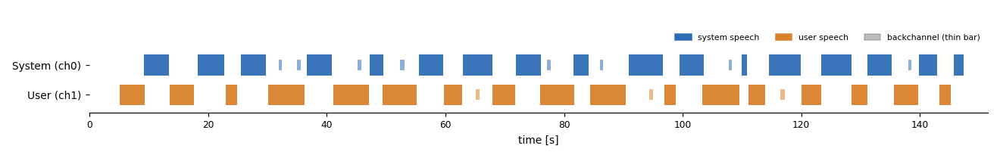
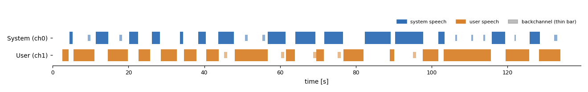
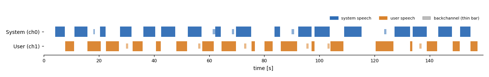
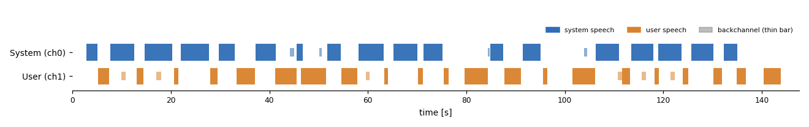
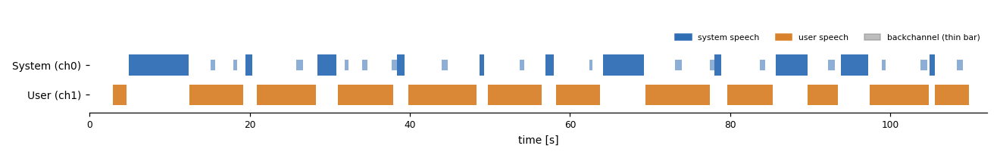
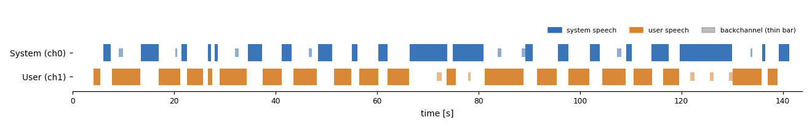
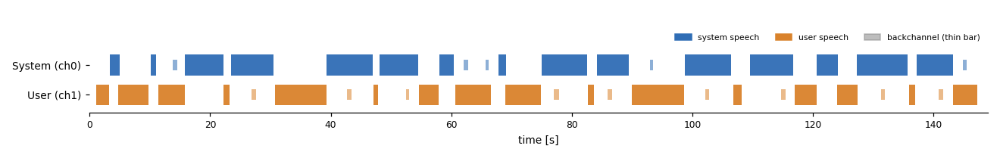
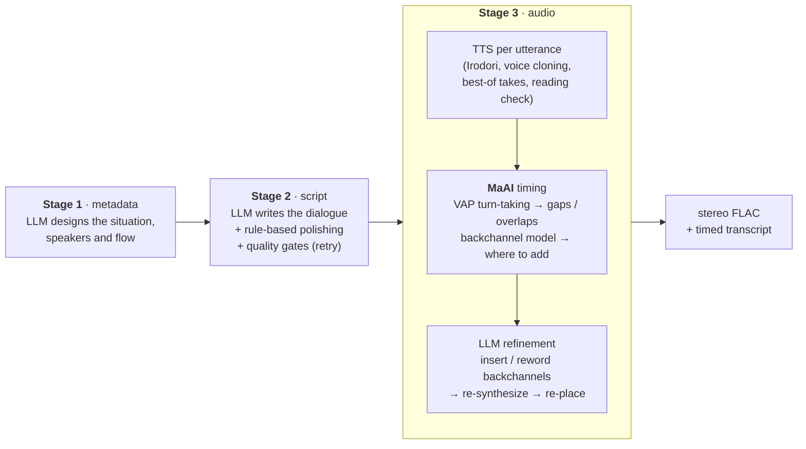
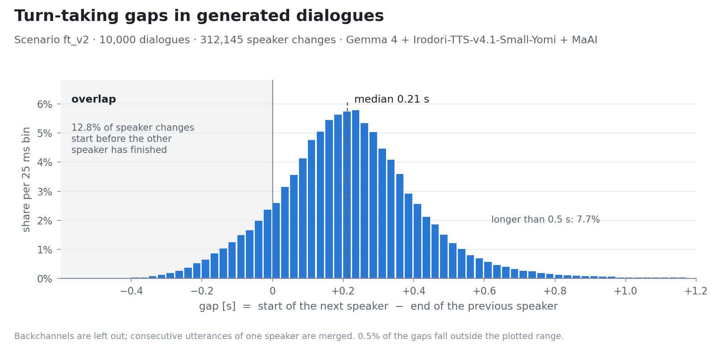

<h1>
<p align="center">MaAI-Synth</p>
</h1>

<p align="center">An end-to-end pipeline that synthesizes <b>natural spoken dialogues</b><br>
with <b>turn-taking, overlaps and backchannels</b> — LLM scripts → TTS → timing by <a href="https://github.com/MaAI-Kyoto/MaAI">MaAI</a></p>
<p align="center">
📄 README: <a href="README.md">English</a> | <a href="README_JP.md">Japanese (日本語)</a>
<br>
🎧 Listen to all samples: <a href="https://maai-kyoto.github.io/MaAI-Synth/">https://maai-kyoto.github.io/MaAI-Synth/</a>
</p>

<b>MaAI-Synth</b> generates two-party spoken dialogues, from the situation design to the final stereo audio.
An LLM writes the scenario and the script (with fillers, sentence-final particles and short turns, checked by
quality gates), a voice-cloning TTS reads every utterance in the voice of a given speaker, and
<a href="https://github.com/MaAI-Kyoto/MaAI"><b>MaAI</b></a> decides <i>when</i> each utterance starts and where
backchannels go, so that the result sounds like a real conversation rather than a sequence of read-aloud lines.
Each speaker is on its own channel (ch0 = system side, ch1 = user side), with time-aligned transcripts,
which makes the output directly usable as training data for full-duplex spoken dialogue models.

<br>

## 🎧 Samples

All samples below were generated with the default settings of this repository
(LLM: Gemma 4 31B, TTS: Irodori-TTS-v4.1-Small-Yomi, timing: MaAI).
The system side (ch0, left) uses the voice of **Inoue**, the user side (ch1, right) the voice of **Mori**.
Each picture shows who speaks when (blue = system, orange = user, thin bars = backchannels).
GitHub cannot play audio inside a README — click **▶ Listen** to open the player page with transcripts.

| Scenario | What happens | Sample |
|---|---|---|
| **First meeting**<br>`ft_v1` | Two people meet for the first time and chat | <br>[▶ Listen](https://maai-kyoto.github.io/MaAI-Synth/#ft_v1_04) · [mp3](docs/samples/ft_v1_04.mp3) |
| **First meeting v2**<br>`ft_v2` | Same, with a persona card for the user side and a topic plan | <br>[▶ Listen](https://maai-kyoto.github.io/MaAI-Synth/#ft_v2_04) · [mp3](docs/samples/ft_v2_04.mp3) |
| **Long silences**<br>`ft_sil_v1` | The user side sometimes thinks for a long time before answering | <br>[▶ Listen](https://maai-kyoto.github.io/MaAI-Synth/#ft_sil_v1_02) · [mp3](docs/samples/ft_sil_v1_02.mp3) |
| **Long silences v2**<br>`ft_sil_v2` | Long silences + user persona cards | <br>[▶ Listen](https://maai-kyoto.github.io/MaAI-Synth/#ft_sil_v2_02) · [mp3](docs/samples/ft_sil_v2_02.mp3) |
| **Attentive listening**<br>`al_v1` | The user talks about an episode, the system listens with many backchannels | <br>[▶ Listen](https://maai-kyoto.github.io/MaAI-Synth/#al_v1_02) · [mp3](docs/samples/al_v1_02.mp3) |
| **Overlapping speech**<br>`rp_v1` | Interruptions, simultaneous starts, collaborative completions | <br>[▶ Listen](https://maai-kyoto.github.io/MaAI-Synth/#rp_v1_01) · [mp3](docs/samples/rp_v1_01.mp3) |
| **Question answering**<br>`qa_v1` | The user asks questions, the system answers | <br>[▶ Listen](https://maai-kyoto.github.io/MaAI-Synth/#qa_v1_03) · [mp3](docs/samples/qa_v1_03.mp3) |

35 dialogues (7 scenarios × 5) are on the [sample page](https://maai-kyoto.github.io/MaAI-Synth/) (source: [`docs/`](docs/)).

<br>

## 🆕 Update

- First public release: Stage 1–3, 10 scenarios, Gemma 4 + Irodori-TTS-v4.1-Small-Yomi + MaAI (MaaiBatch) by default,
  voice banks of Inoue and Mori (November 2026)

<br>

## 🧭 How it works



| Stage | Command | Output |
|---|---|---|
| 1 · metadata | `python pipeline/main.py --config configs/<scenario>.yaml --stage metadata` | `data/<scenario>/metadata.jsonl` |
| 2 · script | `python pipeline/main.py --config configs/<scenario>.yaml --stage dialogue` | `dialogues.jsonl`, `voice_dialogues.jsonl` |
| 3 · audio | `python pipeline/generate_tts.py --config configs/<scenario>.yaml --retime-refine` | `audio/maai_ref/*.flac`, `transcripts_maai_ref.jsonl` |

`python pipeline/main.py --config ...` without `--stage` runs Stage 1 and 2 together.

### Stage 3 and MaAI

Stage 3 is where MaAI comes in. The script only says *what* is said; MaAI decides *when*.

1. **TTS** — every utterance is synthesized separately with the voice of its speaker
   (several takes; the best one is chosen by naturalness, speaking rate, pauses and an ASR reading check).
2. **Turn-taking with MaAI** — utterances are placed one after another. At each turn boundary the last 20 s of
   the dialogue built so far (both channels, real synthesized audio) is fed to MaAI's
   <b>Voice Activity Projection (VAP)</b> model, and the start of the next utterance is sampled from its prediction.
   This produces human-like gaps, quick responses and short overlaps instead of a fixed pause (figure below).
3. **Backchannels with MaAI** — MaAI's backchannel model scans the listener's channel for moments where a
   backchannel is likely (*うん*, *はい*, *へえ* ...). An LLM sees these candidates and decides which to insert,
   reword or delete (density is kept within human ranges); the new backchannels are synthesized and placed with MaAI again.

<p align="center">
  <picture>
    <source media="(prefers-color-scheme: dark)" srcset="docs/img/gap_distribution_dark.png">
    
  </picture>
</p>

The figure shows the gap at every speaker change in 10,000 dialogues of the `ft_v2` scenario that we generated
with the default models (Gemma 4, Irodori-TTS-v4.1-Small-Yomi, MaAI) and the Stage 3 settings of `configs/ft_v2.yaml`
(only the user-side voices came from a larger voice bank). A negative gap is an overlap: the next speaker starts before
the previous one has finished. The median gap is 0.21 s; 12.8% of speaker changes overlap and 7.7% leave more than
0.5 s of silence. Backchannels are not counted. To draw the same figure for your own output, run
`python tools/plot_gap_distribution.py data/<scenario>/transcripts_maai_ref.jsonl`.

MaAI is used through its offline batch API `maai.MaaiBatch` (`tts.retime.backend: maaibatch`, the default),
which gives the same predictions as the real-time `Maai` while processing whole dialogues on the GPU.
See [readme/pipeline.md](readme/pipeline.md) for details.

<br>

## 🚀 Getting Started

You need a Linux machine with an NVIDIA GPU (48 GB for the default LLM, ~8 GB for the TTS server and a few GB
for Stage 3) and Python 3.10+. Stage 1–2 alone need no GPU on the client side (they only talk to an LLM server).

```bash
git clone https://github.com/MaAI-Kyoto/MaAI-Synth.git && cd MaAI-Synth

# 1. Python packages (Stage 1-2: requirements.txt only)
python3 -m venv .venv && source .venv/bin/activate
pip install -r requirements-tts.txt          # torch: install the build that matches your CUDA first

# 2. MaAI (Stage 3 timing)
bash scripts/setup_maai.sh                   # -> ./MaAI (MaaiBatch)

# 3. Servers (each in its own terminal / environment)
CUDA_VISIBLE_DEVICES=0 bash scripts/serve_llm.sh          # Gemma 4 31B (vLLM)            -> :8001
bash scripts/setup_irodori_server.sh                      # once, in a separate venv (Python 3.12)
CUDA_VISIBLE_DEVICES=1 bash scripts/serve_irodori.sh      # Irodori-TTS v4.1 Small Yomi    -> :8980

# 4. Persona pool for the scenarios with user persona cards (ft_v2, ft_sil_v2, al_v1, rp_v1, qa_v1)
#    see readme/personas.md (downloads two public datasets and builds personas/partner_pool.jsonl)

# 5. Generate 2 dialogues of the first-meeting scenario
python pipeline/main.py        --config configs/ft_v1.yaml --target 2
python pipeline/generate_tts.py --config configs/ft_v1.yaml --retime-refine --gpu 0
ls data/ft_v1/audio/maai_ref/                # stereo FLAC, 48 kHz (ch0 = system, ch1 = user)
```

Full instructions (environments, multiple GPUs, troubleshooting): [readme/setup.md](readme/setup.md).

<br>

## 🎬 Scenarios

| Config | Scenario | Notes |
|---|---|---|
| `configs/ft_v1.yaml` | First meeting | 32-turn chit-chat between strangers |
| `configs/ft_v2.yaml` | First meeting v2 | + persona cards for the user side, topic plans |
| `configs/ft_sil_v1.yaml` | First meeting + long silences | long thinking pauses on the user side |
| `configs/ft_sil_v2.yaml` | First meeting + long silences v2 | + persona cards |
| `configs/ft_5min_v1.yaml` | First meeting, ~5 min | 62–78 turns, hops across topics |
| `configs/al_v1.yaml` | Attentive listening | the user tells an episode, the system listens |
| `configs/rp_v1.yaml` | Overlapping speech | interruptions, simultaneous starts, collaborative completions |
| `configs/qa_v1.yaml` | Question answering | the user asks, the system answers |
| `configs/main_v1.yaml` | General conversation | varied situations and relationships |
| `configs/tri_ft_v1.yaml` | Three-party first meeting | experimental; `pipeline/main_tri.py` / `pipeline/generate_tts_tri.py`, needs ≥ 2 user-side voices |

In every scenario the system side (ch0) is "イノウエ (Inoue)", male, 30s (`metadata.main_speaker`).
In the first-meeting, listening, overlap and QA scenarios he is a university researcher with a fixed persona
(`personas/`). How to write your own scenario:
[readme/scenarios.md](readme/scenarios.md).

<br>

## 🗣️ Voice banks

A voice bank is a CSV with ~30-second reference clips of one speaker. Two banks are included:

| Bank | Speaker | Used for | Clips |
|---|---|---|---|
| [`voices/inoue/`](voices/inoue/) | Inoue (male, 30s) | system side (`tts.main_voices_file`) | 10 × 27–32 s, 48 kHz |
| [`voices/mori/`](voices/mori/) | Mori (male) | user side (`tts.voices_file`) | 5 × 32–33 s, 48 kHz |

Add your own speakers by placing clips in `voices/<name>/wav/` and listing them in `voices/<name>/voices.csv`;
several banks can be combined (`tts.voices_file: [voices/mori/voices.csv, voices/you/voices.csv]`) and voices are
assigned per dialogue by gender and age. See [readme/voice_bank.md](readme/voice_bank.md).
**Use only voices you have the right to use**, and follow the terms of the voice data (see License).

<br>

## 🔌 Using other LLMs and TTS engines

- **LLM** — any OpenAI-compatible server (vLLM, SGLang, llama.cpp, Ollama ...) or the OpenAI API:
  change `model`, `llm.base_urls` and `tts.refine.base_urls` in `configs/base.yaml`.
- **TTS** — a TTS method is a YAML file in `tts_presets/` selected by `tts.engine`.
  New engines plug in as an HTTP server (`POST /v1/audio/speech`) or a synthesizer class in `pipeline/generate_tts.py`.
- **Language** — the prompts, settings and models shipped in this release are for Japanese; support for English and
  other languages is planned. The language-dependent parts are listed in
  [readme/extending.md](readme/extending.md#dialogue-language).

> [!IMPORTANT]
> **Check the terms of use before switching.** Many LLM and TTS services offered through an API do not allow their
> outputs to be used for training generative AI models, and some downloadable models have similar conditions.
> Because this pipeline makes training data, check the terms of use of every service and model you use, and use
> them at your own responsibility.

See [readme/extending.md](readme/extending.md).

<br>

## 📦 Output

```
data/<scenario>/
├── metadata.jsonl                  Stage 1
├── dialogues.jsonl                 Stage 2 (script)
├── voice_dialogues.jsonl           Stage 2 (input of Stage 3)
├── audio/maai_ref/<id>.flac        final stereo audio, 48 kHz (ch0 = system, ch1 = user)
├── transcripts_maai_ref.jsonl      per-utterance start/end, channel, speaker, type (speech / backchannel), text
└── voice_dialogues_refined_maai_ref.jsonl   script that matches the audio exactly
```

Format details: [readme/output.md](readme/output.md).

<br>

## 📚 Publication

If you use this repository (the code, the voice banks or data generated with it) in your work,
please cite the following paper 🙏

> 📄 **The paper describing MaAI-Synth will be released soon.** Its reference and BibTeX entry will be added here.

<br>

## 📝 License

- **Source code**: MIT License (see [LICENSE](LICENSE)). The MIT license covers only the source code of this repository.
- **Generated data**: dialogues, scripts and audio generated with this pipeline are **subject to the licenses and terms of
  use of the models and data used to make them** — the LLM (e.g. the Gemma terms of use), the TTS model and codec,
  the voice banks ([voices/LICENSE.md](voices/LICENSE.md)) and the persona datasets (CC BY 4.0 / CC BY-SA 4.0).
  Check these terms before you use or distribute generated data, especially for commercial use or for training models.
  The same applies when you switch to other LLMs, TTS engines or voices. The samples in `docs/` were made with
  Gemma 4, Irodori-TTS-v4.1-Small-Yomi and the Inoue / Mori voice banks and follow their terms.
- **Voice banks** (`voices/`): provided only for research and for trying this pipeline; see [voices/LICENSE.md](voices/LICENSE.md).
  Do not use them to imitate the speakers or for any purpose that would harm them.
- **Models and data used by the pipeline** follow their own licenses, e.g.
  [Gemma](https://ai.google.dev/gemma/terms) (LLM),
  [Irodori-TTS-v4.1-Small-Yomi](https://huggingface.co/takuma104/Irodori-TTS-v4.1-Small-Yomi) /
  [Irodori-TTS](https://github.com/Aratako/Irodori-TTS) (TTS, MIT; its model card prohibits impersonation and misleading deepfakes),
  [MaAI](https://github.com/MaAI-Kyoto/MaAI) (timing),
  [vLLM-Omni](https://github.com/vllm-project/vllm-omni) (TTS server, Apache-2.0),
  [Nemotron-Personas-Japan](https://huggingface.co/datasets/nvidia/Nemotron-Personas-Japan) (CC BY 4.0) and
  [RealPersonaChat](https://github.com/nu-dialogue/real-persona-chat) (CC BY-SA 4.0) for the persona pool.
  See [THIRD_PARTY.md](THIRD_PARTY.md).

Most comments in the source code are written in Japanese.

<br>

## 📬 Contact

For research collaboration, please contact [Koji Inoue](https://inokoj.github.io/) at Kyoto University.
