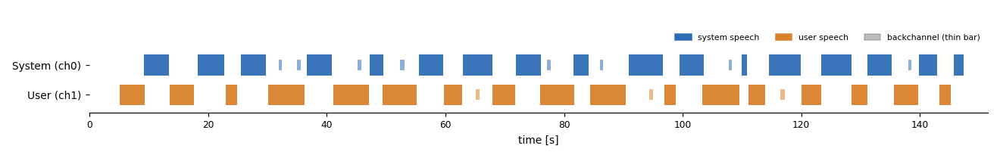
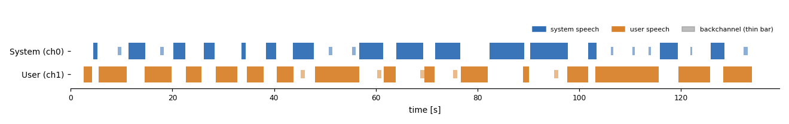
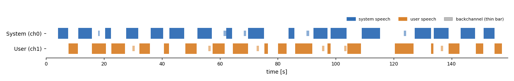
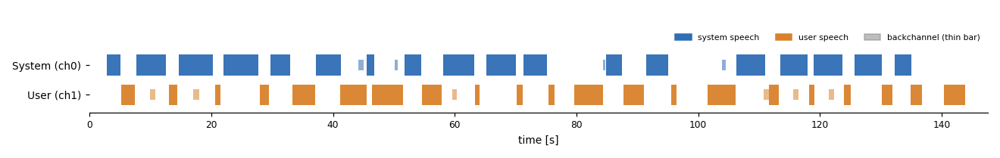
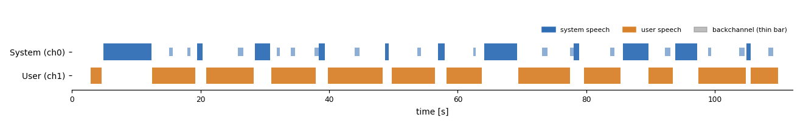
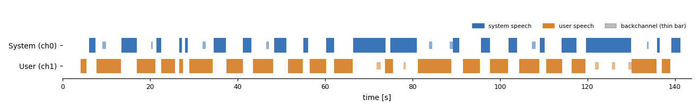
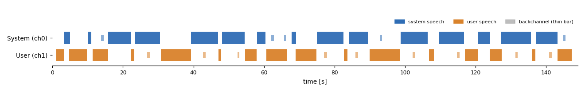
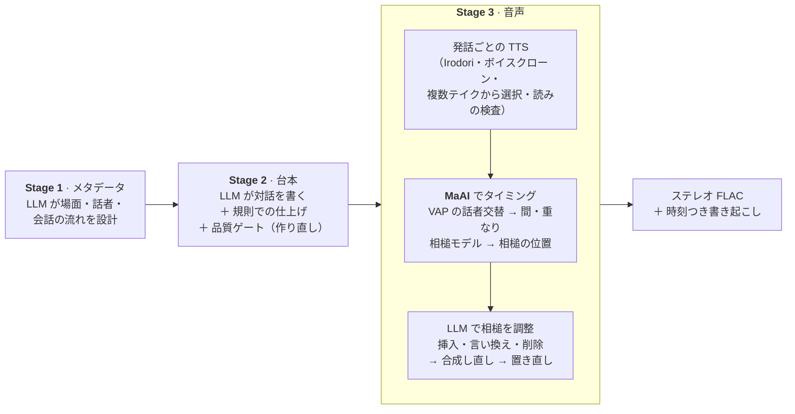

<h1>
<p align="center">MaAI-Synth</p>
</h1>

<p align="center"><b>ターンテイキング・声の重なり・相槌</b>まで含めた<b>自然な音声対話</b>を<br>
一気通貫で合成するパイプライン — LLM で台本 → TTS → <a href="https://github.com/MaAI-Kyoto/MaAI">MaAI</a> でタイミング</p>
<p align="center">
📄 README: <a href="README.md">English</a> | <a href="README_JP.md">Japanese (日本語)</a>
<br>
🎧 サンプルをすべて聴く: <a href="https://maai-kyoto.github.io/MaAI-Synth/">https://maai-kyoto.github.io/MaAI-Synth/</a>
</p>

<b>MaAI-Synth</b> は、2人の音声対話を、場面の設計から最終的なステレオ音声まで自動で作ります。
LLM が場面と台本を書き（フィラー・終助詞・短いターンを織り込み、品質ゲートで検査）、ボイスクローン型の TTS が
各発話を指定した話者の声で読み上げ、<a href="https://github.com/MaAI-Kyoto/MaAI"><b>MaAI</b></a> が
<i>いつ</i>話し始めるか・どこに相槌を入れるかを決めます。台本を順に読み上げただけの音声ではなく、実際の会話に近い
音声になります。話者ごとに別のチャネル（ch0 = システム側、ch1 = ユーザ側）に入り、時刻つきの書き起こしが付くので、
全二重の音声対話モデルの学習データとしてそのまま使えます。

<br>

## 🎧 サンプル

以下はすべて、このリポジトリの既定の設定（LLM: Gemma 4 31B、TTS: Irodori-TTS-v4.1-Small-Yomi、タイミング: MaAI）で
作ったものです。システム側（ch0・左）は **Inoue（イノウエ）**、ユーザ側（ch1・右）は **Mori（モリ）** の声です。
図は誰がいつ話しているかを示します（青 = システム、橙 = ユーザ、細い帯 = 相槌）。
GitHub の README の中では音声を再生できないので、**▶ 聴く** から書き起こしつきの再生ページを開いてください。

| シナリオ | 内容 | サンプル |
|---|---|---|
| **初対面の雑談**<br>`ft_v1` | 初めて会った2人の雑談 | <br>[▶ 聴く](https://maai-kyoto.github.io/MaAI-Synth/#ft_v1_04) · [mp3](docs/samples/ft_v1_04.mp3) |
| **初対面の雑談 v2**<br>`ft_v2` | ユーザ側の人物カードと話題の組み立てつき | <br>[▶ 聴く](https://maai-kyoto.github.io/MaAI-Synth/#ft_v2_04) · [mp3](docs/samples/ft_v2_04.mp3) |
| **長い沈黙**<br>`ft_sil_v1` | ユーザ側がときどき長く考えてから答える | <br>[▶ 聴く](https://maai-kyoto.github.io/MaAI-Synth/#ft_sil_v1_02) · [mp3](docs/samples/ft_sil_v1_02.mp3) |
| **長い沈黙 v2**<br>`ft_sil_v2` | 長い沈黙＋ユーザ側の人物カード | <br>[▶ 聴く](https://maai-kyoto.github.io/MaAI-Synth/#ft_sil_v2_02) · [mp3](docs/samples/ft_sil_v2_02.mp3) |
| **傾聴**<br>`al_v1` | ユーザが出来事を話し、システムが相槌を打ちながら聞く | <br>[▶ 聴く](https://maai-kyoto.github.io/MaAI-Synth/#al_v1_02) · [mp3](docs/samples/al_v1_02.mp3) |
| **声が重なる場面**<br>`rp_v1` | 割り込み・同時に話し始める・相手の言葉を引き取る | <br>[▶ 聴く](https://maai-kyoto.github.io/MaAI-Synth/#rp_v1_01) · [mp3](docs/samples/rp_v1_01.mp3) |
| **質問応答**<br>`qa_v1` | ユーザが質問し、システムが答える | <br>[▶ 聴く](https://maai-kyoto.github.io/MaAI-Synth/#qa_v1_03) · [mp3](docs/samples/qa_v1_03.mp3) |

[サンプルページ](https://maai-kyoto.github.io/MaAI-Synth/) で 35 対話（7 シナリオ × 5）を聴けます（元ファイルは [`docs/`](docs/)）。

<br>

## 🆕 更新情報

- 初回公開: Stage1〜3・11 シナリオ・既定で Gemma 4 ＋ Irodori-TTS-v4.1-Small-Yomi ＋ MaAI（MaaiBatch）・
  Inoue と Mori のボイスバンク（2026年11月）

<br>

## 🧭 しくみ



| ステージ | コマンド | 出力 |
|---|---|---|
| 1 · メタデータ | `python pipeline/main.py --config configs/<シナリオ>.yaml --stage metadata` | `data/<シナリオ>/metadata.jsonl` |
| 2 · 台本 | `python pipeline/main.py --config configs/<シナリオ>.yaml --stage dialogue` | `dialogues.jsonl`・`voice_dialogues.jsonl` |
| 3 · 音声 | `python pipeline/generate_tts.py --config configs/<シナリオ>.yaml --retime-refine` | `audio/maai_ref/*.flac`・`transcripts_maai_ref.jsonl` |

`--stage` を付けずに `python pipeline/main.py --config ...` とすると Stage1 と 2 を続けて行います。

### Stage3 と MaAI

MaAI を使うのは Stage3 です。台本が決めるのは「何を言うか」だけで、「いつ言うか」は MaAI が決めます。

1. **TTS** — 発話を1つずつ、その話者の声で合成します（複数テイクを作り、自然さ・話速・間・ASR による読みの検査で1本を選ぶ）。
2. **MaAI による話者交替** — 発話を先頭から順に並べていきます。話者が替わるたびに、それまでにできた対話の直近 20 秒
   （両チャネル・実際に合成した音声）を MaAI の <b>Voice Activity Projection（VAP）</b> モデルに入れ、その予測から次の発話の
   開始時刻を引きます。決まった長さの間ではなく、人間らしい間・すばやい応答・短い重なりになります。
3. **MaAI による相槌** — MaAI の相槌モデルで、聞き手のチャネルに相槌（うん・はい・へえ など）が入りやすい時点を探します。
   LLM がこの候補を見て、どれを入れるか・言い換えるか・消すかを決めます（密度は人間の範囲に収める）。
   新しい相槌を合成し、もう一度 MaAI で配置します。

MaAI は一括推論の API `maai.MaaiBatch` で使います（`tts.retime.backend: maaibatch`・既定）。リアルタイム版の `Maai` と
同じ予測を、対話まるごと GPU でまとめて計算します。詳しくは [readme/pipeline_JP.md](readme/pipeline_JP.md)。

<br>

## 🚀 はじめかた

NVIDIA GPU のある Linux マシン（既定の LLM に 48 GB、TTS サーバに約 8 GB、Stage3 に数 GB）と Python 3.10 以上が必要です。
Stage1〜2 だけならクライアント側に GPU は要りません（LLM サーバと通信するだけ）。

```bash
git clone https://github.com/MaAI-Kyoto/MaAI-Synth.git && cd MaAI-Synth

# 1. Python パッケージ（Stage1〜2 だけなら requirements.txt で足りる）
python3 -m venv .venv && source .venv/bin/activate
pip install -r requirements-tts.txt          # torch は先に CUDA に合うものを入れる

# 2. MaAI（Stage3 のタイミング）
bash scripts/setup_maai.sh                   # -> ./MaAI（MaaiBatch）

# 3. サーバ（それぞれ別の端末・環境で）
CUDA_VISIBLE_DEVICES=0 bash scripts/serve_llm.sh          # Gemma 4 31B（vLLM）            -> :8001
bash scripts/setup_irodori_server.sh                      # 最初に1回・別の venv で（Python 3.12）
CUDA_VISIBLE_DEVICES=1 bash scripts/serve_irodori.sh      # Irodori-TTS v4.1 Small Yomi    -> :8980

# 4. ユーザ側の人物カードを使うシナリオ（ft_v2・ft_sil_v2・al_v1・rp_v1・qa_v1）のための母集団
#    readme/personas_JP.md を参照（公開データセット2つを取ってきて personas/partner_pool.jsonl を作る）

# 5. 初対面の雑談を 2 対話作る
python pipeline/main.py        --config configs/ft_v1.yaml --target 2
python pipeline/generate_tts.py --config configs/ft_v1.yaml --retime-refine --gpu 0
ls data/ft_v1/audio/maai_ref/                # ステレオ FLAC・48 kHz（ch0 = システム、ch1 = ユーザ）
```

詳しい手順（環境の分け方・複数 GPU・困ったとき）: [readme/setup_JP.md](readme/setup_JP.md)

<br>

## 🎬 シナリオ

| config | シナリオ | 備考 |
|---|---|---|
| `configs/ft_v1.yaml` | 初対面の雑談 | 初めて会った2人の 32 ターン前後の雑談 |
| `configs/ft_v2.yaml` | 初対面の雑談 v2 | ＋ユーザ側の人物カード・話題の組み立て |
| `configs/ft_sil_v1.yaml` | 初対面＋長い沈黙 | ユーザ側が長く考え込む間 |
| `configs/ft_sil_v2.yaml` | 初対面＋長い沈黙 v2 | ＋人物カード |
| `configs/ft_5min_v1.yaml` | 初対面・約5分 | 62〜78 ターン・話題を渡り歩く |
| `configs/al_v1.yaml` | 傾聴 | ユーザが出来事を話し、システムが聞き役 |
| `configs/rp_v1.yaml` | 声が重なる場面 | 割り込み・同時発話・相手の言葉の引き取り |
| `configs/qa_v1.yaml` | 質問応答 | ユーザが質問し、システムが答える |
| `configs/cs_v1.yaml` | 接客 | システムが担当者、ユーザが客 |
| `configs/main_v1.yaml` | いろいろな会話 | さまざまな場面と間柄 |
| `configs/tri_ft_v1.yaml` | 三人の初対面 | 試験的・`pipeline/main_tri.py` / `pipeline/generate_tts_tri.py`・ユーザ側の声が2人以上必要 |

どのシナリオでもシステム側（ch0）は「イノウエ」（男性・30代）です（`metadata.main_speaker`）。初対面・傾聴・重なり・
質問応答では人物設定（`personas/`）を固定した大学の研究者、接客では担当者になります。
シナリオの作り方: [readme/scenarios_JP.md](readme/scenarios_JP.md)

<br>

## 🗣️ ボイスバンク

ボイスバンクは、1人の話者の約 30 秒の参照音声を並べた CSV です。次の2つが入っています。

| バンク | 話者 | 使いどころ | 音声 |
|---|---|---|---|
| [`voices/inoue/`](voices/inoue/) | Inoue（男性・30代） | システム側（`tts.main_voices_file`） | 27〜32 秒 × 10・48 kHz |
| [`voices/mori/`](voices/mori/) | Mori（男性） | ユーザ側（`tts.voices_file`） | 32〜33 秒 × 5・48 kHz |

自分の話者を足すには、音声を `voices/<名前>/wav/` に置き、`voices/<名前>/voices.csv` に並べます。
複数のバンクを組み合わせられ（`tts.voices_file: [voices/mori/voices.csv, voices/you/voices.csv]`）、
対話ごとに性別と年代で声が割り当てられます。詳しくは [readme/voice_bank_JP.md](readme/voice_bank_JP.md)。
**使う権利のある声だけを使ってください。** 音声データの条件はライセンスの節を参照してください。

<br>

## 🔌 ほかの LLM・TTS を使う

- **LLM** — OpenAI 互換のサーバ（vLLM・SGLang・llama.cpp・Ollama など）や OpenAI API ならどれでも使えます。
  `configs/base.yaml` の `model`・`llm.base_urls`・`tts.refine.base_urls` を変えます。
- **TTS** — TTS の方式は `tts_presets/` の YAML で、`tts.engine` で選びます。新しいエンジンは HTTP サーバ
  （`POST /v1/audio/speech`）か `pipeline/generate_tts.py` の合成クラスとして足せます。
- **言語** — この公開版に同梱したプロンプト・設定・モデルは日本語用です。英語やほかの言語への対応を予定しています。
  言語に依存する部分は [readme/extending_JP.md](readme/extending_JP.md#対話の言語) にまとめています。

> [!IMPORTANT]
> **替える前に利用規約を確認してください。** API で提供される LLM・TTS には、出力を生成 AI モデルの学習に使うことを
> 禁じているものが多くあります。配布されているモデルにも同じような条件が付いていることがあります。このパイプラインは
> 学習用のデータを作るためのものなので、使うサービス・モデルの利用規約を確認のうえ、各自の責任で使ってください。

詳しくは [readme/extending_JP.md](readme/extending_JP.md)。

<br>

## 📦 出力

```
data/<シナリオ>/
├── metadata.jsonl                  Stage1
├── dialogues.jsonl                 Stage2（台本）
├── voice_dialogues.jsonl           Stage2（Stage3 の入力）
├── audio/maai_ref/<id>.flac        最終的なステレオ音声・48 kHz（ch0 = システム、ch1 = ユーザ）
├── transcripts_maai_ref.jsonl      発話ごとの開始・終了・チャネル・話者・種類（発話 / 相槌）・本文
└── voice_dialogues_refined_maai_ref.jsonl   音声と完全に一致する台本
```

形式の詳細: [readme/output_JP.md](readme/output_JP.md)

<br>

## 📚 論文・参考文献

本リポジトリ（コード・ボイスバンク・これを使って生成したデータ）を利用した成果を発表する際は、以下の論文を引用してください🙏

> 📄 **MaAI-Synth の論文は近日公開予定です。** 公開後、ここに書誌情報と BibTeX を掲載します。

<br>

## 📝 ライセンス

- **ソースコード**: MIT License（[LICENSE](LICENSE)）。MIT License が適用されるのは、このリポジトリのソースコードだけです。
- **生成したデータ**: このパイプラインで作った対話・台本・音声は、**作るのに使ったモデルやデータのライセンス・利用規約に従う必要があります**。
  LLM（Gemma の利用規約など）、TTS のモデルとコーデック、ボイスバンク（[voices/LICENSE.md](voices/LICENSE.md)）、
  人物カードのデータセット（CC BY 4.0 / CC BY-SA 4.0）が該当します。生成データを使う・配布する前に、特に商用利用やモデルの学習に
  使う場合は、これらの条件を確認してください。ほかの LLM・TTS・声に替えた場合も同じです。`docs/` のサンプルは Gemma 4・
  Irodori-TTS-v4.1-Small-Yomi・Inoue / Mori のボイスバンクで作ったもので、それらの条件に従います。
- **ボイスバンク**（`voices/`）: 研究と、このパイプラインを試す目的に限って提供します。[voices/LICENSE.md](voices/LICENSE.md) を参照。
  話者になりすます用途や、話者の不利益になる用途には使わないでください。
- **パイプラインが使うモデル・データ** はそれぞれのライセンスに従います。例:
  [Gemma](https://ai.google.dev/gemma/terms)（LLM）、
  [Irodori-TTS-v4.1-Small-Yomi](https://huggingface.co/takuma104/Irodori-TTS-v4.1-Small-Yomi) /
  [Irodori-TTS](https://github.com/Aratako/Irodori-TTS)（TTS・MIT。モデルカードではなりすましと人を欺くディープフェイクを禁止）、
  [MaAI](https://github.com/MaAI-Kyoto/MaAI)（タイミング）、
  [vLLM-Omni](https://github.com/vllm-project/vllm-omni)（TTS サーバ・Apache-2.0）、
  人物カードの母集団には [Nemotron-Personas-Japan](https://huggingface.co/datasets/nvidia/Nemotron-Personas-Japan)（CC BY 4.0）と
  [RealPersonaChat](https://github.com/nu-dialogue/real-persona-chat)（CC BY-SA 4.0）。
  [THIRD_PARTY.md](THIRD_PARTY.md) を参照。

ソースコード中のコメントは主に日本語です。

<br>

## 📬 連絡先

共同研究などのご相談は、京都大学の [井上 昂治](https://inokoj.github.io/) までご連絡ください。
